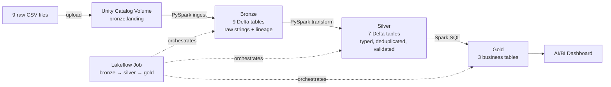
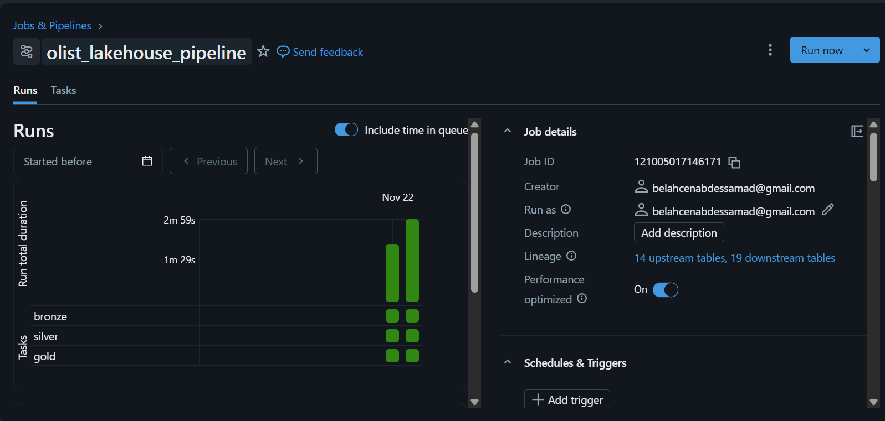
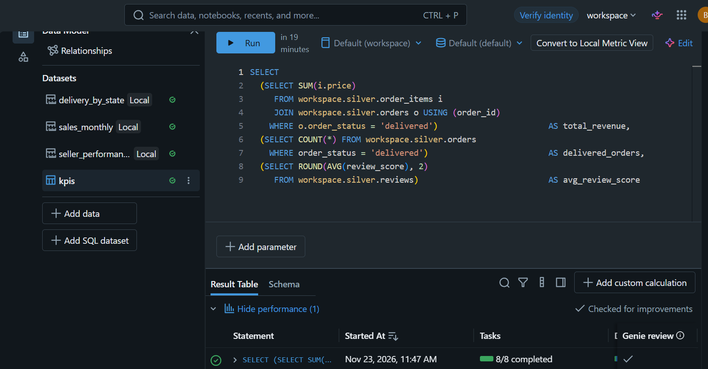

# Olist Lakehouse on Databricks

End-to-end data pipeline on Databricks built with the medallion architecture (bronze → silver → gold) on ~100k real e-commerce orders from Olist, a Brazilian marketplace. The pipeline runs as an orchestrated job and feeds an AI/BI dashboard.

## Architecture

## Stack

- **Databricks Free Edition** (serverless compute)
- **PySpark** and **Spark SQL**
- **Delta Lake**
- **Unity Catalog**: catalog / schemas per layer / volume for raw files
- **Lakeflow Jobs**: multi-task job with dependencies
- **AI/BI Dashboards**
- **Git folders** synced with this repository

## Project structure

| Notebook | Layer | What it does |
|---|---|---|
| `00_setup` | – | Creates the `bronze`, `silver`, `gold` schemas and the landing volume (run once) |
| `01_bronze_ingest` | Bronze | Loads the 9 CSVs into Delta tables as raw strings, adds `_ingested_at` and `_source_file` lineage columns |
| `02_silver_transform` | Silver | Casts types, parses timestamps, deduplicates, standardizes cities/states, translates product categories to English, computes delivery metrics, runs data-quality checks |
| `03_gold_aggregates` | Gold | Builds business tables: monthly sales by category, delivery performance by state, seller performance |

## Design choices

- **Bronze keeps everything as strings.** No schema inference at ingestion, so bad values never fail the load. All typing happens in silver.
- **Lineage columns.** Every bronze row records when it was ingested and from which file.
- **Multi-line CSV parsing.** Customer reviews contain line breaks; `multiLine` + `escape` options prevent broken rows.
- **Reviews deduplication.** The source has duplicate reviews; silver keeps the latest answer per `(review_id, order_id)` with a window function.
- **Source typos fixed in silver.** `product_name_lenght` → `product_name_length`, etc.
- **Data-quality checks.** Null keys, orphan order items, negative prices, checked at the end of the silver notebook.
- **Geolocation intentionally skipped.** ~1M rows with many duplicates per zip code, and no gold table needs it.
- **Gold KPIs computed from silver.** Summing gold aggregates would double-count orders spanning several categories, so dashboard KPIs query silver directly.

## Gold tables

| Table | Grain | Main metrics |
|---|---|---|
| `gold.sales_monthly` | month × category | orders, revenue, freight, average order value |
| `gold.delivery_by_state` | customer state | delivered orders, avg delivery days, % late, avg review score |
| `gold.seller_performance` | seller (≥10 orders) | orders, revenue, avg review score, % late |

## Key results

- **Total revenue (delivered orders):** R$ 13.22M
- **Late deliveries hurt satisfaction:** late orders average a review score of 2.57 vs 4.29 for on-time orders.
- **[One more finding from the dashboard, e.g. the state with the highest late rate or the top category by revenue.]**

## Screenshots

### Job run

### Dashboard

## How to run

1. Create a [Databricks Free Edition](https://www.databricks.com/learn/free-edition) workspace.
2. Clone this repo as a Git folder (Workspace → Create → Git folder).
3. Run `00_setup`.
4. Download the [Olist dataset](https://www.kaggle.com/datasets/olistbr/brazilian-ecommerce) and upload the 9 CSVs to `/Volumes/workspace/bronze/landing/olist/`.
5. Create a job with three notebook tasks: `01_bronze_ingest` → `02_silver_transform` → `03_gold_aggregates`, and run it.

## Next steps

- **Auto Loader** for incremental ingestion instead of full overwrites
- **Lakeflow Declarative Pipelines** with expectations for data quality
- **CI/CD** with Databricks Asset Bundles
- **AI layer**: sentiment and topic classification on review text with Databricks AI functions
